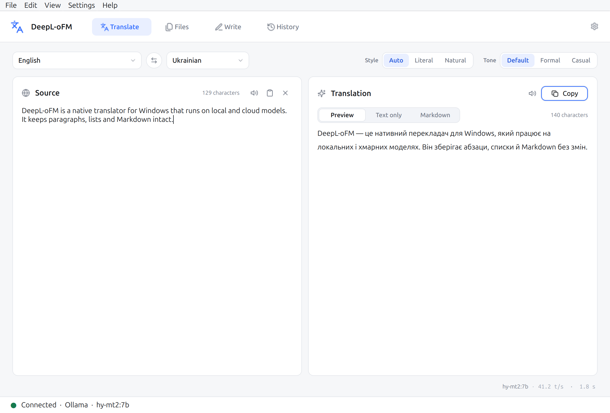
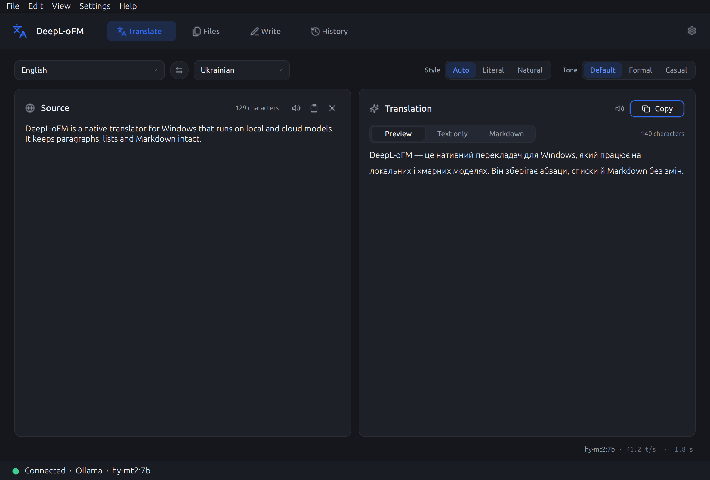
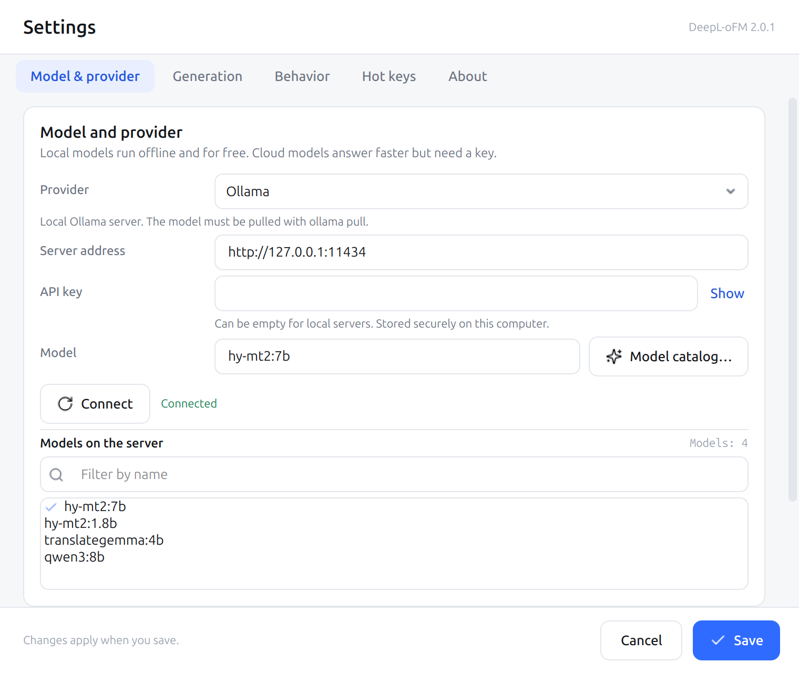
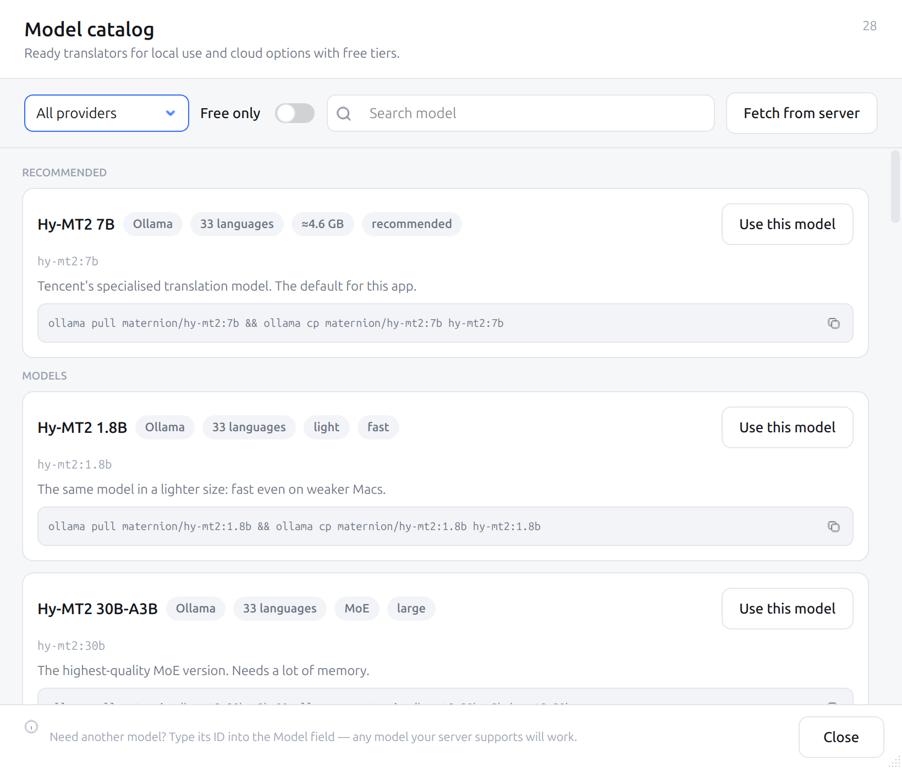
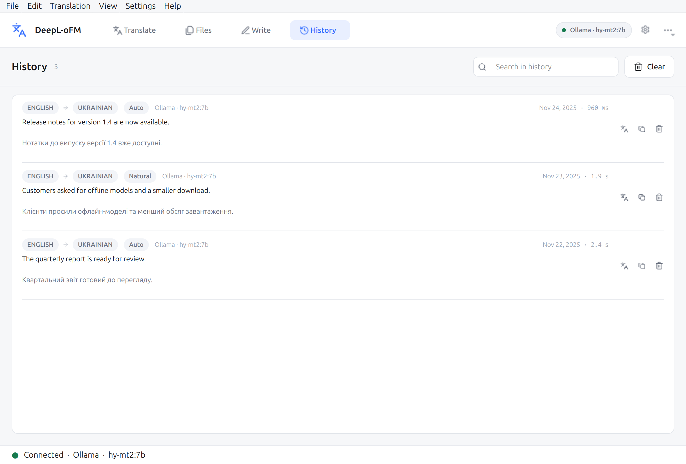
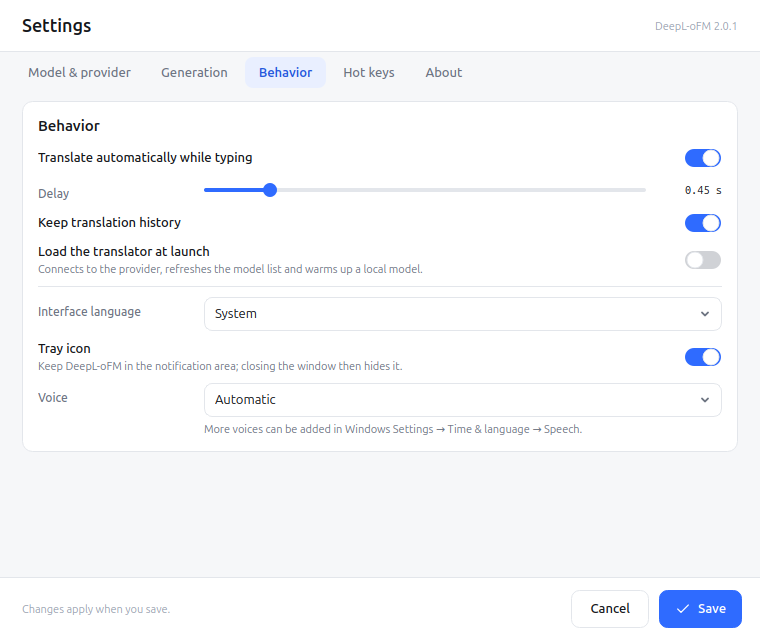
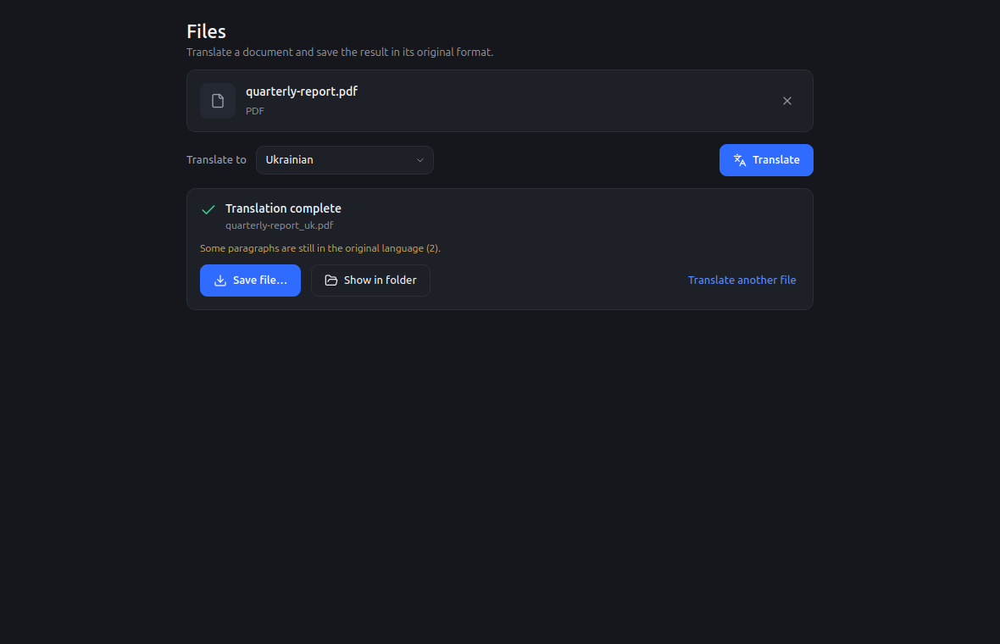
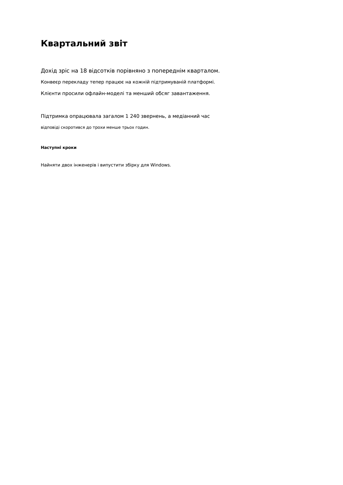
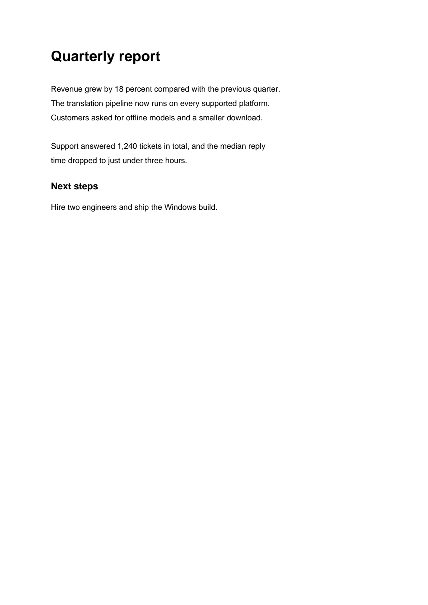

# DeepL-oFM для Windows

Клон [DeepL-oFM](https://github.com/Lexus2016/deepl-on-free-models) — нативного
macOS-переводчика, переписанный на **Python 3 + PySide6**, чтобы работать под
Windows. Ядро перевода, промпты, защита токенов, разбор документов и логика
провайдеров перенесены из оригинального Swift-кода один в один; интерфейс
перерисован с нуля на Qt в той же визуальной логике.

> Оригинальный репозиторий и macOS-приложение находятся в корне проекта,
> этот каталог (`windows/`) — самостоятельная Windows-версия.

## Что умеет

- **Перевод в двух панелях**: оригинал и перевод, прогресс в процентах, кнопка
  остановки, автоматический перевод при вводе (с настраиваемой задержкой).
- **Провайдеры**: Ollama (локально), Ollama Cloud, LM Studio, oMLX, llama.cpp,
  OpenRouter, Groq, Cerebras и любой OpenAI-совместимый endpoint.
- **38 вариантов 33 языков** Hy-MT2 с поиском по списку.
- **Стили** Auto / Literal / Natural и **тона** Default / Formal / Casual — как в
  карточке модели Hy-MT2.
- **Каталог моделей** с готовыми командами установки, фильтром «только
  бесплатные», живым списком моделей сервера («Получить с сервера») и выбором
  модели, которой нет в каталоге.
- **Файлы**: `.txt`, `.md`, `.pdf`, `.docx`. DOCX переписывается «на месте» —
  стили, таблицы, изображения и колонтитулы остаются нетронутыми; PDF получает
  переведённый текст поверх исходных блоков с сохранением страниц и графики.
- **DeepL Write** — вкладка переписывания текста (ясность, грамматика, стиль).
- **Markdown**: три режима результата — предпросмотр, чистый текст и исходный
  Markdown; копирование отдаёт ровно тот формат, который выбран, а режим
  предпросмотра кладёт в буфер Markdown, HTML и RTF одновременно. Кнопка-«глаз»
  в панели оригинала показывает вставленный Markdown отрендеренным.
- **История** с поиском, копированием, удалением и повтором перевода.
- **Глобальные горячие клавиши**: `Ctrl+Alt+T` — перевести буфер обмена,
  `Ctrl+Alt+C` — скопировать выделенный текст в любом приложении и перевести.
- **Озвучивание** оригинала и перевода (системный синтез речи Windows):
  кнопки-динамики в шапке каждой панели, «Стоп» там же, выбор голоса —
  **Настройки → Поведение → Голос** (голоса фильтруются по языку перевода).
- **9 языков интерфейса**: English, Українська, Русский, Deutsch, Français,
  Español, Polski, Português, Italiano — с мгновенным переключением.
- **Провайдер-резерв**: если основной провайдер упал, текст автоматически
  уходит на резервный.
- **Трей**: приложение живёт в системном трее, закрытие окна не завершает работу.

## Скриншоты

| | |
|---|---|
|  |  |
| **Перевод:** две панели, стиль и тон, прогресс, метрики | **Тёмная тема:** следует оформлению Windows |
|  |  |
| **Настройки:** провайдер, ключ, список моделей, резерв | **Каталог:** 28 моделей с командами установки |
|  |  |
| **История:** поиск, копирование, повтор перевода | **Поведение:** темп, трей, голос озвучки |
|  |  |
| **Файлы:** перевод документа и сохранение | **PDF:** перевод поверх исходной вёрстки |

## Требования

- Windows 10 или 11 (64-бит).
- **Python 3.10–3.13** — [python.org/downloads](https://www.python.org/downloads/windows/).
  Рекомендуется **Python 3.12** (x64): под него есть готовые колёса у всех
  зависимостей, включая PySide6. При установке отметьте **Add python.exe to PATH**.
  `run.bat` сам выберет 3.12 → 3.13 → 3.11 → последнюю установленную.
- Для локального перевода — [Ollama для Windows](https://ollama.com/download).

## Быстрый старт

1. Склонируйте репозиторий и перейдите в каталог `windows`:

   ```bat
   git clone https://github.com/Lexus2016/deepl-on-free-models.git
   cd deepl-on-free-models\windows
   ```

2. Запустите `run.bat`. При первом запуске он создаст `.venv`, поставит
   зависимости и откроет приложение. Повторные запуски — мгновенные.

3. Скачайте модель (пример для Ollama):

   ```bat
   ollama pull maternion/hy-mt2:7b
   ollama cp maternion/hy-mt2:7b hy-mt2:7b
   ```

4. В приложении: **Настройки → Модель и провайдер** → выберите Ollama →
   нажмите **Подключить** → выберите `hy-mt2:7b` → **Сохранить**.

Без Ollama можно сразу подключить облако: OpenRouter, Groq или Cerebras —
достаточно вставить свой API-ключ.

## Если Python уже стоит

Проверить версию:

```bat
py -0p            :: список установленных интерпретаторов с путями
py -3.12 --version
```

Нужен любой выпуск от 3.10 до 3.13; 3.12 — самый предсказуемый. Если стоит
только 3.9 или 3.14, поставьте рядом 3.12: несколько версий Python сосуществуют
без конфликтов, `run.bat` выберет нужную сам.

## Сборка .exe

```bat
build_exe.bat
```

Скрипт поставит PyInstaller, соберёт иконку и положит готовое приложение в
`dist\DeepL-oFM\`. Каталог можно переносить целиком; внутри — `DeepL-oFM.exe`.
Python на целевой машине при этом не нужен.

## Горячие клавиши

| Сочетание | Действие |
|---|---|
| `Ctrl+Alt+T` | перевести текст из буфера обмена и показать окно |
| `Ctrl+Alt+C` | скопировать выделенный текст в активном приложении и перевести |
| `Ctrl+Shift+C` | скопировать перевод |
| `Ctrl+Enter` | перевести сейчас (меню «Перевод») |
| `Ctrl+Shift+S` | поменять языки местами |
| `Ctrl+S` | сохранить переведённый документ (вкладка «Файлы») |
| `Ctrl+,` | настройки |
| `Ctrl+N` | новый перевод |
| `Ctrl+O` | открыть файл во вкладке «Файлы» |

Оба глобальных сочетания настраиваются в **Настройки → Горячая клавиша**.
В отличие от macOS-версии, разрешение Accessibility не требуется: Windows
позволяет отправлять `Ctrl+C` активному окну без отдельного разрешения.

Как работает перевод выделенного: приложение отпускает модификаторы хоткея,
отправляет `Ctrl+C` активному окну и ждёт смены номера буфера обмена (до 0,7 с).
Ограничение Windows: если целевая программа запущена **от имени администратора**,
а DeepL-oFM — нет, система блокирует синтетическое нажатие (UIPI), и текст не
скопируется. Запустите приложение с тем же уровнем прав — или скопируйте текст
вручную и нажмите `Ctrl+Alt+T`.

## Провайдеры

| Провайдер | Тип | Ключ | Примечание |
|---|---|---|---|
| Ollama | локально | не нужен | модели `-cloud` работают после `ollama signin` |
| Ollama Cloud | облако | нужен | напрямую `https://ollama.com/v1` |
| LM Studio | локально | обычно не нужен | локальный сервер |
| oMLX | локально | обычно не нужен | MLX-сервер (Apple Silicon) |
| llama.cpp | локально | обычно не нужен | `llama-server --api` |
| OpenRouter | облако | нужен | бесплатные модели с суффиксом `:free` |
| Groq | облако | нужен | бесплатный тариф с лимитами |
| Cerebras | облако | нужен | самый быстрый инференс open-моделей |
| Custom | любой | опционально | любой OpenAI-совместимый endpoint |

Ключи хранятся в **Диспетчере учётных данных Windows** (через `keyring`), а если
он недоступен — в файле, зашифрованном **DPAPI** под текущего пользователя.
В репозиторий и логи ключи не попадают.

## Файлы

Вкладка **Файлы** — отдельная форма: выберите или перетащите `.txt`, `.md`,
`.pdf`, `.docx`, укажите язык и нажмите **Перевести**. Результат сохраняется с
кодом языка в имени (`report.pdf` → `report_uk.pdf`).

- **TXT и Markdown** сохраняют разрывы абзацев; блоки кода в ``` ``` ``` не
  переводятся.
- **DOCX** сохраняет исходный пакет: переписывается только `word/document.xml`,
  поэтому стили, изображения, таблицы, списки и шрифты остаются как были.
- **PDF** сохраняет исходные страницы и графику, а переведённый текст рисуется
  поверх исходных блоков. Исходный текстовый слой не удаляется. Для сканов
  сначала нужен OCR.

| До перевода | После перевода |
|---|---|
|  |  |

## Командная строка

`run.bat` передаёт аргументы приложению:

```bat
run.bat --prefill "Hello world"      :: открыть с готовым текстом
run.bat --tab files                  :: сразу на вкладке «Файлы»
run.bat --open-file "C:\docs\report.pdf"
run.bat --write-text "text to improve"
run.bat --translate-clipboard        :: перевести текущий буфер обмена
run.bat --connect                    :: подключиться к провайдеру и загрузить модели
run.bat --catalog                    :: открыть каталог моделей
run.bat --debug                      :: запуск с журналом в консоли
```

Журнал приложения пишется в `%APPDATA%\DeepL-oFM\logs\app.log`.

## Где хранятся данные

| Что | Где |
|---|---|
| Настройки | `%APPDATA%\DeepL-oFM\settings.json` |
| История | `%APPDATA%\DeepL-oFM\history.json` |
| Ключи API | Диспетчер учётных данных Windows (`ua.admin.hymt`) |
| Резервная копия ключей | `%APPDATA%\DeepL-oFM\secrets.dat` (DPAPI) |

## Отличия от macOS-версии

- Обновления: Sparkle 2 и подписанный appcast — только для macOS. В
  Windows-версии есть пункт **Справка → Сайт** и версия в **О программе**.
- Keychain заменён на Диспетчер учётных данных Windows / DPAPI.
- Accessibility API не используется: `Ctrl+C` отправляется напрямую.
- PDF собирается через `pdfplumber` + `reportlab` + `pypdf`; расположение
  переведённых блоков приближено к оригинальному, но не является побайтово
  идентичным исходной вёрстке.

## Тесты

```bash
cd windows
.venv\Scripts\python -m pytest tests -q
```

Набор покрывает промпты, нарезку текста, защиту токенов, 38 языков и 9 языков
интерфейса, настройки, DOCX/PDF/TXT, историю, ключи, горячие клавиши, синтез
речи и сквозной перевод через настоящий локальный HTTP-сервер (Ollama NDJSON и
OpenAI SSE). Отдельный headless-тест собирает все вкладки и диалоги:

```bash
.venv\Scripts\python tools\smoke_test.py
```

## Разработка

```bash
cd windows
python -m venv .venv
.venv\Scripts\pip install -r requirements.txt
.venv\Scripts\python -m pytest tests -q      # тесты
.venv\Scripts\python -m deepl_ofm --debug    # запуск с логами
```

Структура:

```
deepl_ofm/
  core/        языки, промпты, провайдеры, настройки, нарезка текста, токены,
               каталог моделей, горячие клавиши как модель
  services/    перевод (Ollama/OpenAI-стриминг), документы, история, ключи,
               горячие клавиши, синтез речи
  support/     преобразование HTML/RTF из буфера обмена в Markdown
  ui/          тема, иконки, компоненты, вкладки, диалоги, трей
  i18n/        каталог из 9 языков интерфейса + таблица Windows-строк
  controller.py  состояние приложения и фоновые задачи
  app.py         точка входа
tests/         pytest: промпты, нарезка, токены, языки, настройки, документы,
               перевод через настоящий локальный HTTP-сервер, интерфейс,
               история, i18n, сквозной сценарий пользователя
```

Контракты модулей и границы ответственности описаны в
[`CONTRACTS.md`](CONTRACTS.md).

## Диагностика

- **«Не удалось подключиться»** — проверьте, что `ollama serve` запущен и адрес
  `http://127.0.0.1:11434` доступен; нажмите **Подключить**.
- **Модель не найдена** — имя должно совпадать с `ollama list`; список моделей
  подтягивается кнопкой **Подключить**.
- **HTTP 401/403** — проверьте API-ключ.
- **Часть строк осталась на исходном языке** — нажмите **Повторить** или
  смените стиль на Natural / модель побольше.
- **Горячая клавиша не срабатывает** — сочетание занято другой программой;
  задайте другое.
- **Тёмная/светлая тема** — приложение следует теме системы.

```bat
set DEEPLOFM_DEBUG=1
run.bat
```

## Лицензия

Код — MIT, как и в оригинальном проекте. Модель Hy-MT2 7B распространяется
Tencent по собственной лицензии.
